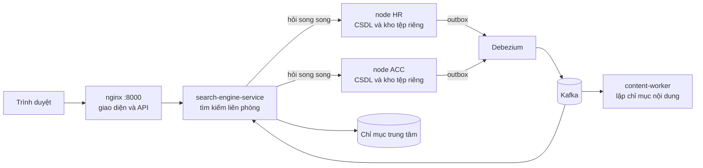

# DMS Enterprise: hệ thống quản lý tài liệu phân tán theo phòng ban

Hệ thống quản lý tài liệu cho doanh nghiệp có nhiều phòng ban. Mỗi phòng ban giữ cơ sở dữ liệu và kho tệp riêng, gọi là **node**. Tìm kiếm liên phòng ban truy vấn đồng thời các node. Một chỉ mục trung tâm được cập nhật qua CDC (Debezium và Kafka), nên vẫn tìm được khi một phòng ban tạm thời không trả lời.

Hệ thống chạy trên **Docker Compose** với khoảng 24 container. Repo chỉ chứa mã nguồn và cấu hình. Các container được build và chạy trên máy của bạn bằng một lệnh: `bash scripts/setup.sh`.

## 1. Cài đặt nhanh

Mở **Git Bash** (trên Windows) và chạy:

```bash
git clone https://github.com/phongpt2005/phattrienphantan.git
cd phattrienphantan
bash scripts/setup.sh
```

Khi xong, mở **http://localhost:8000** và đăng nhập bằng một tài khoản demo (mục 3).

`setup.sh` làm lần lượt: kiểm tra công cụ, tạo `.env` với các mật khẩu ngẫu nhiên, build giao diện và 3 image, chạy stack, rồi chờ gateway sẵn sàng.

- **Lần đầu mất nhiều thời gian**: phải tải các image nền và build 3 image. Các lần sau nhanh hơn. Script chờ gateway tối đa 15 phút.
- **An toàn khi chạy lại**: `.env` đã có giá trị thì được giữ nguyên.
- **Nếu dừng giữa chừng**: xem mục 12 (Xử lý sự cố), rồi chạy lại `bash scripts/setup.sh`.

| Lệnh | Tác dụng |
|---|---|
| `bash scripts/setup.sh` | Cài đặt đầy đủ |
| `bash scripts/setup.sh --verify` | Cài xong thì chạy bộ kiểm thử e2e (vài phút) |
| `bash scripts/setup.sh --only-env` | Chỉ tạo và điền `.env`, không build, không chạy |

## 2. Yêu cầu

| Cần có | Cách lấy | Kiểm tra |
|---|---|---|
| Docker Desktop (có Docker Compose v2) | https://www.docker.com/products/docker-desktop . Trên Windows dùng backend WSL2 | `docker compose version` |
| Git kèm Git Bash | https://git-scm.com | `git --version` |
| Node.js 20 LTS (tối thiểu 18) | https://nodejs.org | `node -v` |
| Internet | Cho lần cài đầu, để tải image nền | |
| Bộ nhớ | Khuyến nghị 16 GB RAM. Khi chạy đủ stack, RAM trống có thể chỉ còn dưới 2 GB, nên đóng bớt ứng dụng khác | |

Chạy mọi lệnh trong **Git Bash**, không chạy `setup.sh` trong PowerShell hay CMD.

Hướng dẫn này được kiểm thử trên Windows 11. macOS và Linux chưa được kiểm thử.

## 3. Tài khoản demo và quyền của từng vai trò

| Tài khoản | Vai trò | Mật khẩu demo | Có thể làm |
|---|---|---|---|
| `hr_staff`, `acc_staff` | Nhân viên | `Staff@123` | Xem tài liệu của phòng và tài liệu được chia sẻ. Gửi yêu cầu xin quyền tài liệu của phòng khác. Không duyệt được yêu cầu, không tạo được chia sẻ, không xem bảng Ban Giám đốc |
| `hr_manager`, `acc_manager` | Trưởng phòng | `Admin@123` | Duyệt yêu cầu xin quyền (tạo lượt chia sẻ). Không xem bảng Ban Giám đốc |
| `admin` | Ban Giám đốc | `Admin@123` | Xem bảng tổng quan toàn doanh nghiệp |

Mật khẩu demo là giá trị cố định trong `DEMO_*` của `.env`. Giao diện có nút đăng nhập nhanh dùng đúng các giá trị này (xem `frontend/src/components/LoginScreen.tsx` và `frontend/src/demo.ts`). Nếu đổi `DEMO_*`, phải sửa cả mã giao diện. Chỉ dùng tài khoản demo trên máy cá nhân.

Gợi ý: đăng nhập lần lượt bằng ba nhóm tài khoản để thấy khác biệt về quyền.

## 4. Hệ thống hoạt động thế nào



- **Ghi dữ liệu**: mỗi thay đổi tài liệu được ghi vào bảng `outbox` của node trong cùng một transaction. Debezium đọc bảng này và đẩy sự kiện vào Kafka. Hệ thống không ghi kép trực tiếp sang nơi khác.
- **Tìm kiếm liên phòng**: search-engine-service hỏi song song các node. Nếu một phòng không trả lời, kết quả vẫn trả về phần còn lại, kèm cờ `isPartial` và danh sách node không phản hồi.
- **Chỉ mục trung tâm**: được cập nhật từ Kafka và dùng làm dự phòng khi một node không trả lời.
- **Đối soát**: định kỳ so sánh số lượng và digest của từng node với chỉ mục trung tâm. Nếu lệch, hệ thống yêu cầu node phát lại sự kiện.

## 5. Lệnh thường dùng

| Việc | Lệnh |
|---|---|
| Xem trạng thái các container | `docker compose ps` |
| Xem log một service | `docker compose logs -f --tail=100 dept-hr` |
| Dừng, giữ dữ liệu | `docker compose stop` |
| Chạy lại sau khi dừng | `docker compose start` |
| Gỡ container, giữ dữ liệu | `docker compose down` |
| Xóa toàn bộ dữ liệu (không khôi phục được) | `docker compose down -v` |

## 6. Thêm và gỡ phòng ban

```bash
bash scripts/add-department.sh SALES "Phòng Kinh doanh"
bash scripts/remove-department.sh SALES
```

`add-department.sh` tạo `departments/sales.env` với các bí mật ngẫu nhiên, dựng CSDL, kho tệp và node riêng cho phòng đó, rồi đăng ký connector CDC. Các node cũ không bị sửa. Thư mục `departments/` nằm trong `.gitignore`.

## 7. Kiểm thử

```bash
bash infrastructure/scripts/e2e-smoke.sh
```

Cần stack đang chạy và `SEED_DEMO_USERS=true`. Bộ kiểm thử gồm xác thực, phân quyền, cô lập phòng ban, tìm kiếm liên phòng, độ trễ đồng bộ, chia sẻ tài liệu và chịu lỗi. Trong lúc chạy, script tạm dừng một số node rồi bật lại. Mất vài phút.

Các kiểm thử khác nằm trong `infrastructure/scripts/`: `revoke-test.sh`, `approval-race-test.sh`, `share-provenance-test.sh`, `restore-test.sh`, `projector-epoch-test.sh`, `rolling-upgrade-test.sh`, `partition-test.sh`. Kịch bản sự cố nằm trong `infrastructure/chaos/`, chạy bằng `python infrastructure/chaos/run_scenario.py <file.json>`.

## 8. Cài đặt thủ công

Dùng khi `setup.sh` gặp lỗi và bạn muốn làm từng bước:

```bash
cp .env.example .env          # rồi điền mọi giá trị CHANGE_ME, ví dụ bằng: openssl rand -hex 24
cd frontend && npm ci && npm run build && cd ..
docker build -f services/department-service/Dockerfile    -t dms/department-service:2.0    .
docker build -f services/search-engine-service/Dockerfile -t dms/search-engine-service:2.0 .
docker build -f services/content-worker/Dockerfile        -t dms/content-worker:2.0        .
docker compose up -d --no-build
```

Sau đó mở http://localhost:8000.

## 9. Cấu trúc thư mục

| Thư mục | Nội dung |
|---|---|
| `services/` | `department-service` (node phòng ban), `search-engine-service` (tìm kiếm liên phòng, registry), `content-worker` (lập chỉ mục nội dung) |
| `packages/` | `database` (Prisma schema và client), `common` (mã dùng chung) |
| `frontend/` | Giao diện React và Vite (build ra `frontend/dist`) |
| `infrastructure/` | Cấu hình nginx, PostgreSQL, Kafka, Debezium, giám sát, kịch bản kiểm thử và chaos, sao lưu |
| `scripts/` | Cài đặt, thêm và gỡ phòng ban |
| `docs/` | Thiết kế, hiện trạng, lộ trình, nhật ký |
| `docker-compose.yml` | Stack chính |
| `docker-compose.department.yml` | Compose riêng cho phòng ban được thêm bằng script |

## 10. Tài liệu

- `docs/README.md`: mục lục.
- `docs/07-implementation-status.md`: hiện trạng từng gói và số đo kiểm thử.
- `docs/10-goi-b-va-c.md`: lộ trình P0 đến P3.
- `docs/08-demo-script.md`: kịch bản demo.
- `docs/05-adr/`: các quyết định kiến trúc.
- `docs/11-p1-kafka-cutover.md`: kế hoạch chuyển Kafka sang cụm ba broker.
- `docs/12-nhat-ky-tien-trinh.md`: nhật ký tiến trình.
- `AGENTS.md` và `.claude/skills/`: quy định làm việc cho trợ lý AI. Không cần để chạy hệ thống.

## 11. Bảo mật

- `.env` và `departments/*.env` chứa bí mật và nằm trong `.gitignore`. Không commit, không gửi qua chat hay email.
- Mật khẩu demo là giá trị công khai. Không dùng cho máy có dữ liệu thật.
- Chỉ hai cổng được mở ra ngoài máy: **8000** (giao diện và API) và **3001** (cổng phòng HR). Grafana (3000), Prometheus (9090) và Jaeger (16686) chỉ lắng nghe trên `127.0.0.1`.
- Script sao lưu `infrastructure/scripts/backup-offsite.sh` ghi vào thư mục OneDrive trên Windows. Nếu không có OneDrive, script từ chối chạy. Bản sao lưu được mã hóa bằng `BACKUP_ENCRYPTION_KEY`. Mất khóa này thì không giải mã được bản sao lưu.

## 12. Xử lý sự cố

- **`setup.sh` báo Docker chưa chạy**: mở Docker Desktop, đợi nó sẵn sàng, rồi chạy lại.
- **Cổng đã bị dùng** (8000, 3001 hoặc cổng giám sát): có ứng dụng khác chiếm cổng. Đổi `NGINX_HTTP_PORT` hoặc `SVC_HR_PORT` trong `.env` rồi chạy lại. Cổng Grafana, Prometheus và Jaeger cố định trong `docker-compose.yml`.
- **`docker compose build` báo** `x-docker-expose-session-sharedkey ... non-printable ASCII`: lỗi đã gặp trên Windows. Dùng `docker build` như mục 8.
- **`npm ci` báo `ERESOLVE`**: repo đã có `frontend/.npmrc` với `legacy-peer-deps=true`. Lỗi xảy ra vì `lucide-react` khai báo peer React tối đa là 18, trong khi dự án dùng React 19.
- **Script `.sh` báo `set: -: invalid option`**: file bị đổi sang CRLF. Clone lại repo. `.gitattributes` đã ép LF cho file `.sh`.
- **Gateway không lên sau khi cài**: chạy `docker compose ps`, rồi `docker compose logs --tail=100 nginx search-engine-service`.
- **Giao diện trắng**: kiểm tra `frontend/dist/index.html`. Nếu thiếu, chạy `cd frontend && npm run build`.
- **Máy hết RAM, container bị dừng**: đóng ứng dụng khác và tăng bộ nhớ cho Docker Desktop.
- **Muốn cài lại từ đầu**: chạy `docker compose down -v` (xóa dữ liệu và volume), xóa `.env`, rồi chạy `bash scripts/setup.sh`. Phải xóa volume, vì mật khẩu CSDL chỉ được đặt khi khởi tạo lần đầu.
- **Nút đăng nhập nhanh không hoạt động**: bạn đã đổi `DEMO_*` trong `.env` nhưng chưa đổi mã giao diện. Xem mục 3.

## 13. Trạng thái và giấy phép

- Trạng thái từng gói: xem `docs/07-implementation-status.md`. Các việc còn mở gồm cụm Kafka ba broker, Patroni cho CSDL trung tâm và phòng HR, và autoscaler theo lag (xem `docs/10-goi-b-va-c.md`).
- **Giấy phép: chưa chọn.** Nếu muốn người khác được sử dụng lại mã, cần thêm file `LICENSE`.
