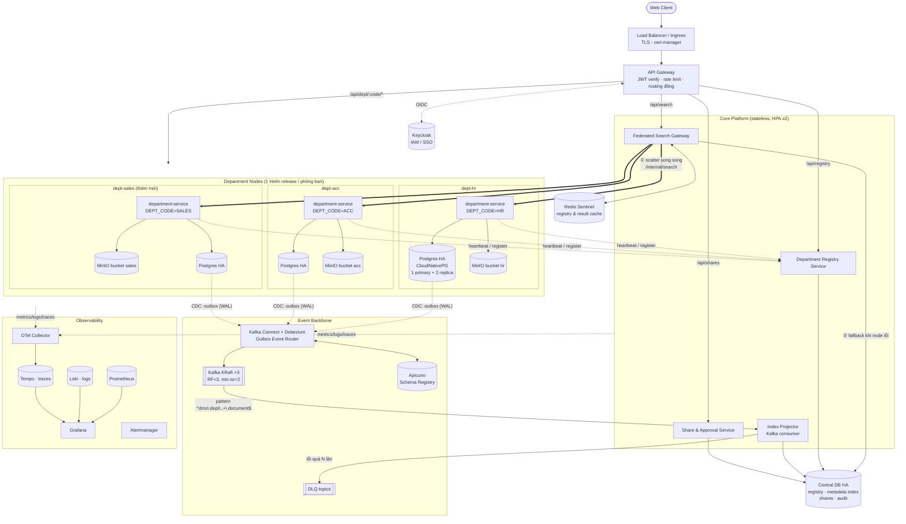
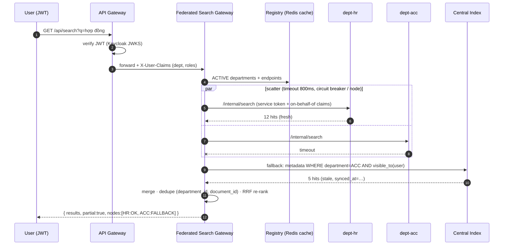
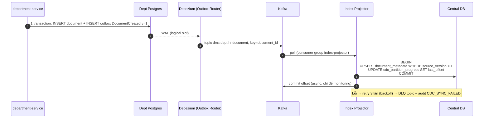
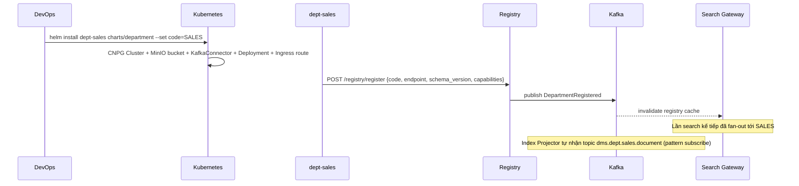

# 02. Kiến trúc mục tiêu: Hybrid Federated Search

> **Lưu ý:** tài liệu này mô tả **thiết kế đích**. Phần đã triển khai và những chỗ khác với thiết kế được liệt kê trong [07-implementation-status.md](07-implementation-status.md).

## 1. Nguyên tắc thiết kế

1. **Mỗi phòng ban sở hữu dữ liệu của mình** (data sovereignty, R1). Dữ liệu gốc và file chỉ nằm ở node của phòng ban. Trung tâm chỉ giữ *bản chiếu metadata*.
2. **Tìm kiếm truy vấn trực tiếp các node** (R2). Đường chính là scatter-gather song song tới các node, nên kết quả luôn là dữ liệu mới nhất.
3. **Ưu tiên tính sẵn sàng khi node gặp sự cố.** Node nào không trả lời kịp thì lấy phần của nó từ Central Index và gắn cờ `stale`. Đây là lựa chọn **AP** trong định lý CAP, với nhất quán cuối cùng (eventual consistency) có giới hạn độ trễ.
4. **Không ai biết trước có những phòng ban nào** (R3). Danh sách phòng ban là *dữ liệu* nằm trong Registry, không nằm trong *code*.
5. **Mọi lời gọi liên dịch vụ đều xác thực.** Người dùng đăng nhập qua OIDC (Keycloak), các dịch vụ gọi nhau bằng service token qua mTLS.

## 2. View 1: Sơ đồ tổng thể



**So với sơ đồ v1:**

- Thêm **Keycloak**, **Department Registry**, **Federated Search Gateway**, **Schema Registry**, **DLQ** và **OTel/Tempo/Loki**.
- Search Engine được tách thành hai phần: *Search Gateway* (phục vụ đọc) và *Index Projector* (ghi Central Index). Đây là CQRS, hai phần scale độc lập với nhau.
- Hai service phòng ban được gộp thành **một image `department-service`**. Mỗi phòng ban là một Helm release.

## 3. View 2: Luồng tìm kiếm Hybrid (R2)



### Quy tắc kỹ thuật

| Vấn đề | Giải pháp |
|---|---|
| Node chậm làm chậm cả request (tail latency) | Timeout cho từng node khoảng 800 ms, tổng ngân sách 1.2 s. Hedged request: gửi thêm một request tới replica đọc nếu quá p95. |
| Node chết liên tục | Circuit breaker riêng cho từng node (thư viện `opossum`). Khi breaker mở, đi thẳng vào fallback. |
| Gộp điểm từ nhiều DB có thang điểm khác nhau | **Reciprocal Rank Fusion**: `score = Σ 1/(60 + rank_i)`. Cách này không phụ thuộc thang điểm `ts_rank` của từng node. |
| Phân trang qua nhiều node | Mỗi node trả top `page*size`. Gateway gộp rồi cắt trang. Dùng cursor `(score, department_id, document_id)` để trang sau ổn định. |
| Phân quyền | **Mỗi node tự lọc** theo claims (dept, role, share). Gateway không tin vào tham số client gửi lên. `isExecutive` lấy từ JWT. |
| Dữ liệu cũ (stale) | Kết quả lấy từ fallback có `stale=true` kèm `synced_at`, UI hiện chú thích "Dữ liệu cập nhật lúc …". |
| Quá tải khi fan-out tới N node | Tối đa 8 lời gọi đồng thời (bulkhead). Kết quả cache Redis theo `hash(q, filters, user-scope)` với TTL 30 s. |

**Hợp đồng `/internal/search`.** Mọi node phải tuân theo hợp đồng này, phiên bản `v1` trong OpenAPI:

```json
// request
{ "q": "hợp đồng", "filters": {"classification": ["DEPARTMENT","COMPANY"]},
  "limit": 40, "viewer": {"sub":"…","dept":"HR","roles":["MANAGER"]} }
// response
{ "department_code": "HR", "took_ms": 37, "schema_version": 1,
  "hits": [{ "document_id":"0193…", "title":"…", "score":0.82, "rank":1,
             "classification":"DEPARTMENT", "updated_at":"…" }] }
```

## 4. View 3: Luồng ghi và đồng bộ (Outbox → CDC → Index)



- **Key của message là `document_id`.** Mọi event của cùng một tài liệu nằm trong cùng một partition, nên giữ đúng thứ tự.
- **Exactly-once về hiệu lực.** Offset được lưu cùng transaction trong `cdc_partition_progress`. Khi khởi động lại, projector `seek` tới offset đã lưu.
- **Chống ghi đè ngược.** Áp dụng điều kiện `source_version` (lấy từ `row_version` của node).

## 5. Onboarding phòng ban mới (R3)



Những thứ **không** phải sửa khi thêm phòng ban:

- code của HR và ACC
- code của Search Gateway và Index Projector
- cấu hình Gateway
- frontend

**Vòng đời của node trong Registry:** `PROVISIONING → ACTIVE → DEGRADED (miss 3 heartbeat) → DRAINING → RETIRED`. Search Gateway chỉ fan-out tới các node `ACTIVE`. Với node `DEGRADED`, gateway đi thẳng vào fallback.

## 6. Tải file liên phòng ban

1. Người dùng phòng ACC bấm "Tải" trên tài liệu của phòng HR được chia sẻ cho mình: `GET /api/search/documents/:centralDocId/download`.
2. Search Gateway kiểm tra phòng ban của người dùng có share `DOWNLOAD` còn hiệu lực (hoặc là chủ sở hữu / Ban Giám đốc). Quyền chỉ `VIEW` bị từ chối (CHỈ XEM - DLP).
3. Gateway gọi node chủ sở hữu `GET /internal/files/:docId/stream` bằng service token. Node ghi audit `DOWNLOAD` kèm người tải và phòng ban.
4. Gateway chuyển tiếp stream cho người dùng. **Địa chỉ MinIO không bao giờ lộ ra ngoài** (lý do không dùng presigned URL: URL chứa host nội bộ, trình duyệt không truy cập được).

Đã kiểm thử: file tải về có SHA-256 trùng bản gốc; thu hồi share thì không còn thấy.

## 7. Các pattern được áp dụng (dùng khi trình bày)

| Pattern | Dùng ở đâu | Giải quyết vấn đề gì |
|---|---|---|
| Database-per-service / Data partitioning | Department nodes | R1, cô lập lỗi và bảo mật |
| Scatter-Gather | Federated Search Gateway | R2 |
| Circuit Breaker, Bulkhead, Timeout | Lời gọi tới từng node | Một node chết không kéo sập cả hệ thống tìm kiếm |
| CQRS + Materialized View | Central Index | Fallback, analytics cho Ban Giám đốc |
| Transactional Outbox | Ghi DB và phát event | Tránh dual-write |
| Idempotent Consumer | Index Projector | Exactly-once về hiệu lực |
| Service Registry + Self-registration + Heartbeat | Registry | R3 |
| Dead Letter Queue | Kafka | Không mất event lỗi |
| Schema Registry (BACKWARD compatibility) | Apicurio | Node mới hoặc cũ không làm vỡ consumer |
| Sidecar observability (OTel) | Mọi service | Trace fan-out, đo p95 |
