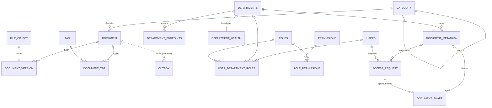

# 03. Thiết kế cơ sở dữ liệu v2

> **Lưu ý:** hai file trong `docs/sql/` là **thiết kế đích** (UUIDv7, `outbox` chung, hash chain...).
> Schema **đang chạy thật** nằm ở `infrastructure/postgres/init-scripts/node/01-schema.sql` và `.../central/01-schema.sql`
> (idempotent, giữ `BIGINT` cục bộ; xem bảng khác biệt trong [07-implementation-status.md](07-implementation-status.md)).

DDL đầy đủ nằm trong hai file:

- [`sql/node-schema.sql`](sql/node-schema.sql): schema của **mỗi node phòng ban**, mọi phòng ban dùng chung một file.
- [`sql/central-schema.sql`](sql/central-schema.sql): IAM, Department Registry, Metadata Index, chia sẻ/phê duyệt và Audit.

> ✅ Đã chạy thử trên **PostgreSQL 16.15** (2026-11-11). Cả hai file chạy không lỗi với `ON_ERROR_STOP=1`. Các hành vi sau đã được kiểm tra:
> - UUID sinh ra là version 7.
> - Tìm `"hop dong"` khớp với `"Hợp đồng"`.
> - `row_version` tự tăng khi UPDATE.
> - Lệnh `DELETE` trên `audit_events` bị chặn.

Ký hiệu: 🆕 bảng hoặc cột mới · ✏️ thay đổi so với `BảngDB.docx` · ✅ giữ nguyên ý tưởng.

## 1. Quy ước chung

| Quy ước | Lý do |
|---|---|
| `TIMESTAMPTZ` thay cho `DATETIME(6)` | Hệ thống chạy Postgres. Kiểu này lưu theo UTC nên so sánh giữa các node không lệch múi giờ. |
| **UUIDv7** cho `document_id` và `file_id` | ID duy nhất trên toàn hệ thống, nên khi gộp kết quả federated không bị trùng. ID tăng dần theo thời gian nên B-tree ít bị phân mảnh hơn UUIDv4. Node có thể tự sinh ID mà không cần điều phối. |
| `JSONB` thay cho `JSON` | Đánh index được, truy vấn được bên trong payload. |
| `CHECK` cho mọi cột trạng thái | Ràng buộc nghiệp vụ nằm ngay trong DB, không chỉ dựa vào code. |
| Text search config `vn_unaccent` | Tìm tiếng Việt không phân biệt có dấu hay không dấu. Thay cho config `'simple'` đang dùng. |
| Định danh tham chiếu chéo DB luôn là cặp `(department_id, document_id)` | Không có FK vật lý giữa các node. Toàn vẹn được đảm bảo bằng event. |

## 2. Nhóm A: Node phòng ban (R1)

Mỗi phòng ban có một database riêng với schema giống hệt nhau. Nhờ vậy chỉ cần **một image dùng chung** và **một Helm chart**.

| Bảng | Cột chính | Khóa và mục đích |
|---|---|---|
| ✏️ `document` | `document_id UUID`, `category_id`, `title`, `description`, 🆕 `classification`, `status`, 🆕 `current_version`, 🆕 `row_version`, `created_by UUID`, `created_at`, `updated_at`, `deleted_at`, 🆕 `search_vector` | PK `document_id` (UUIDv7). **Bỏ `file_id`**, quan hệ với file chuyển sang `document_version`. `classification` ∈ {DEPARTMENT, COMPANY, CONFIDENTIAL}. `row_version` do trigger tăng ở mỗi UPDATE, dùng cho optimistic lock và để sắp thứ tự event CDC. `search_vector` là cột generated với trọng số A cho title, B cho description, có index GIN. **Node tự phục vụ được federated query.** |
| ✅ `file_object` | `file_id UUID`, `file_name`, `storage_key`, `mime_type`, `size_bytes`, `checksum_sha256`, `uploaded_at` | PK `file_id`, UQ `storage_key`. Thêm `CHECK size_bytes >= 0`. |
| 🆕 `document_version` | `document_id`, `version_no`, `file_id`, `change_note`, `created_by`, `created_at` | PK `(document_id, version_no)`. `file_id` UNIQUE. Thay cho quan hệ 1-1 trước đây để **giữ lịch sử phiên bản**. |
| ✅ `category` | `category_id`, `parent_id`, `name`, `description` | Cây danh mục. Thêm `UQ(parent_id, name)`. |
| ✅ `tag`, `document_tag` | Như docx | `document_tag` đổi `doc_id` thành `document_id UUID`. |
| ✏️ `outbox` (thay `AUDIT_OUTBOX`) | `event_id`, 🆕 `aggregate_type`, 🆕 `aggregate_id`, `event_type`, 🆕 `schema_version`, `payload JSONB`, 🆕 `trace_id`, `occurred_at` | Một outbox chung cho **sự kiện tài liệu và audit**. Debezium Outbox Event Router định tuyến theo `aggregate_type`, sang topic `dms.dept.{code}.{aggregate_type}`. `aggregate_id` làm message key để giữ thứ tự. `trace_id` nối trace qua Kafka. |

**Publication chỉ gồm bảng `outbox`.** Bảng nghiệp vụ không bị lộ ra ngoài, nên đổi schema nội bộ không ảnh hưởng tới consumer.

Ví dụ một lần ghi tài liệu, chạy trong cùng một transaction:

```sql
BEGIN;
INSERT INTO document (title, classification, created_by) VALUES ($1, $2, $3) RETURNING document_id, row_version;
INSERT INTO outbox (aggregate_type, aggregate_id, event_type, payload, trace_id)
VALUES ('document', $document_id, 'DocumentCreated',
        jsonb_build_object('document_id',$document_id,'title',$1,'classification',$2,
                           'row_version',$row_version,'updated_at',now()), $trace);
COMMIT;
```

## 3. Nhóm B: IAM và Department Registry (R3)

| Bảng | Cột chính | Mục đích |
|---|---|---|
| ✅ `users` | `user_id UUID`, `identity_issuer`, `identity_subject`, `display_name`, `email`, `status`, `created_at` | `UQ(identity_issuer, identity_subject)` khớp với claim `iss` và `sub` của Keycloak. |
| ✅ `roles`, `permissions`, `role_permissions` | Như docx | RBAC. `scope_type` ∈ {DEPARTMENT, GLOBAL}. |
| ✅ `user_department_roles`, `user_global_roles` | Như docx | Ví dụ: Trưởng phòng là MANAGER@HR, Ban Giám đốc là EXECUTIVE (GLOBAL). |
| ✏️ `departments` | `department_id`, `department_code`, `department_name`, 🆕 `lifecycle` | **Chỉ còn là danh mục.** `lifecycle` ∈ {PROVISIONING, ACTIVE, DEGRADED, DRAINING, RETIRED}. `CHECK` regex cho mã phòng ban. |
| 🆕 `department_endpoints` | `department_id`, `endpoint_kind` (SEARCH/API/FILE), `base_url`, `api_version`, `kafka_topic`, `schema_version` | Tách phần định tuyến ra khỏi `departments.service_route`. **Node tự ghi vào đây khi đăng ký.** Search Gateway đọc bảng này để fan-out. |
| 🆕 `department_health` | `department_id`, `last_heartbeat_at`, `p95_latency_ms`, `circuit_state`, `instance_count` | Heartbeat. Bỏ lỡ 3 nhịp liên tiếp thì phòng ban chuyển sang DEGRADED và Search đi thẳng vào fallback. |

## 4. Nhóm C: Central Index, chia sẻ và Audit

| Bảng | Cột chính | Mục đích |
|---|---|---|
| ✏️ `document_metadata` | Như docx, thêm 🆕 `description`, `category_path`, `tags TEXT[]`, `classification`, `owner_user_id`, `is_deleted`, **`source_version`**, `search_vector` | PK `(department_id, document_id)`. Là **read model dùng làm fallback** khi node lỗi và phục vụ analytics cho Ban Giám đốc. Upsert theo điều kiện `WHERE source_version < EXCLUDED.source_version`, nên event đến muộn không ghi đè được dữ liệu mới. |
| ✏️ `cdc_partition_progress` | 🆕 `consumer_group`, `topic`, `partition_id`, `last_offset`, `updated_at` | PK thêm `consumer_group` để nhiều projector (index, analytics) dùng chung bảng. |
| 🆕 `access_request` | `request_id`, `owner_department_id`, `document_id`, `requester_user_id`, `requester_department_id`, `requested_permission`, `reason`, `status`, `decided_by`, `decided_at` | Luồng xin quyền. Unique partial index bảo đảm **mỗi người chỉ có một yêu cầu PENDING trên mỗi tài liệu**. Có `CHECK` không cho xin quyền trên tài liệu của chính phòng ban mình. |
| 🆕 `document_share` | `share_id`, `owner_department_id`, `document_id`, `target_department_id`, `permission` (VIEW/DOWNLOAD), `source_request_id`, `granted_by`, `granted_at`, `expires_at`, `revoked_at`, `revoked_by` | Thu hồi quyền dùng **soft revoke** để giữ lại dấu vết. Unique partial index bảo đảm mỗi cặp (tài liệu, phòng ban) chỉ có một share đang hiệu lực. **Bảng này đang thiếu trong repo, khiến code bị lỗi.** |
| ✏️ `audit_events` | Như docx, thêm 🆕 `trace_id`, `prev_hash`, `hash` | `PARTITION BY RANGE (occurred_at)` theo tháng, nên xóa dữ liệu cũ chỉ cần `DETACH` partition. Trigger chặn UPDATE và DELETE. **Hash chain** `hash = sha256(prev_hash ‖ row)` giúp phát hiện khi có người sửa audit. |

### Upsert idempotent của Index Projector

```sql
BEGIN;
INSERT INTO document_metadata AS m (department_id, document_id, title, classification, status,
       created_at, source_updated_at, source_version, is_deleted)
VALUES ($dept, $doc, $title, $class, $status, $created, $updated, $ver, $deleted)
ON CONFLICT (department_id, document_id) DO UPDATE
SET title = EXCLUDED.title, classification = EXCLUDED.classification, status = EXCLUDED.status,
    source_updated_at = EXCLUDED.source_updated_at, source_version = EXCLUDED.source_version,
    is_deleted = EXCLUDED.is_deleted, synced_at = now()
WHERE m.source_version < EXCLUDED.source_version;          -- chống ghi đè ngược

INSERT INTO cdc_partition_progress (consumer_group, topic, partition_id, last_offset)
VALUES ('index-projector', $topic, $partition, $offset)
ON CONFLICT (consumer_group, topic, partition_id) DO UPDATE SET last_offset = EXCLUDED.last_offset, updated_at = now();
COMMIT;
```

## 5. Sơ đồ quan hệ



Nhóm bảng `DOCUMENT…OUTBOX` nằm ở **từng node**. Các nhóm còn lại nằm ở **Central DB**. Hai phía nối với nhau bằng event, đi theo đường `OUTBOX → Kafka → DOCUMENT_METADATA`.

## 6. Ước lượng dung lượng và index

| Bảng | Tăng trưởng (ví dụ 5 phòng ban × 2.000 tài liệu/tháng) | Chiến lược |
|---|---|---|
| `document` (node) | ~2k dòng/tháng/node | GIN trên `search_vector`, partial index `deleted_at IS NULL` |
| `outbox` (node) | ~10k dòng/tháng/node | Job xóa dòng cũ hơn 7 ngày (event đã nằm trong Kafka) |
| `document_metadata` | ~10k dòng/tháng | GIN `search_vector`, GIN `tags` |
| `audit_events` | ~1M dòng/tháng | Partition theo tháng. Giữ 12 tháng online, cũ hơn thì detach và lưu ra cold storage |
