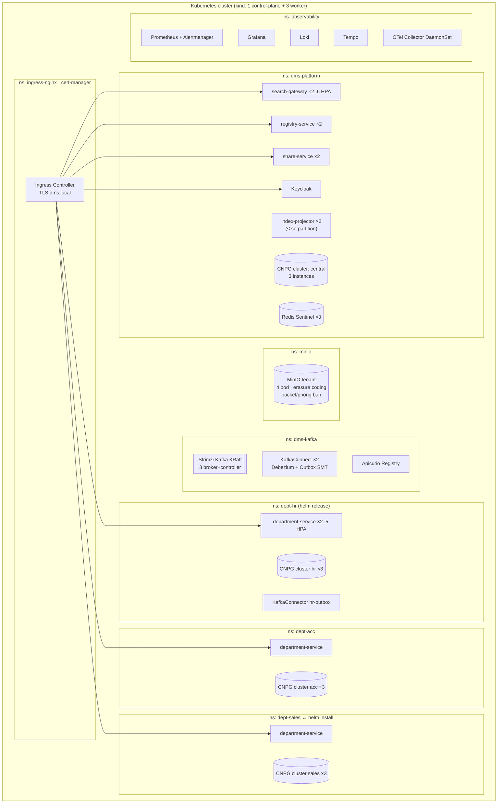
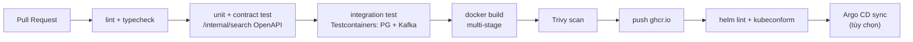

# 04. Mô hình triển khai

> **Cập nhật 2026-11-17:** Kubernetes đã được gỡ khỏi dự án theo yêu cầu (môi trường phát triển có tài nguyên hạn chế). Phần Kubernetes dưới đây là thiết kế tham khảo, không còn được triển khai. Mọi kiểm thử và demo chạy trên Docker Compose.
>
> **Lưu ý:** tài liệu này mô tả **thiết kế đích**. **Đã triển khai: Docker Compose (mục 5). Chưa triển khai: Kubernetes/Helm, quan sát (Loki/Tempo).** Chi tiết: [07-implementation-status.md](07-implementation-status.md).

Hệ thống được triển khai ở hai môi trường, dùng **cùng một image** và **cùng một hợp đồng cấu hình**:

| Môi trường | Mục đích | Công cụ chính | Tài nguyên cần |
|---|---|---|---|
| **Dev**: Docker Compose | Lập trình viên chạy cục bộ, debug nhanh | Compose v2 dùng *project name* và *env file* cho từng phòng ban | ~6 GB (2 phòng ban) |
| **Demo/Prod-like**: Kubernetes | Bảo vệ đề tài: HA, failover, onboarding bằng một lệnh | kind/minikube, Helm, **CloudNativePG**, **Strimzi**, MinIO Operator, Keycloak, kube-prometheus-stack, Loki, Tempo | 12–16 GB (3 phòng ban) |

## 1. Topology triển khai trên Kubernetes



**Lý do tách mỗi phòng ban thành một namespace:**

- Kết hợp `ResourceQuota` với `NetworkPolicy` để thể hiện *cô lập dữ liệu ở tầng hạ tầng*, không chỉ dựa vào `DepartmentGuard` trong code.
- Gỡ một phòng ban chỉ cần một lệnh: `helm uninstall` cộng `kubectl delete ns`.

## 2. Bộ công cụ và lý do chọn

| Thành phần | Công cụ | Vì sao chọn (để trả lời hội đồng) |
|---|---|---|
| Cluster local | **kind** (hoặc minikube) | Cluster nhiều node chạy bằng Docker. Mô phỏng được việc một node chết. |
| Đóng gói | **Helm 3** | Một chart `department` dùng chung cho mọi phòng ban, thể hiện R3 bằng một lệnh. |
| Postgres HA | **CloudNativePG** operator | Tự failover, giữ replication slot khi failover (PG17 hoặc `replicationSlots.synchronizeReplicas`), backup lên MinIO bằng barman, PodMonitor có sẵn. Thay thế cách tự viết `pg_basebackup` trong compose. |
| Kafka + CDC | **Strimzi** operator | Kafka KRaft (không cần ZooKeeper). Khai báo `KafkaTopic`, `KafkaConnect` và `KafkaConnector` dưới dạng CRD, nên connector nằm trong Helm chart và không phải gọi `curl` đăng ký thủ công. |
| Schema event | **Apicurio Registry** | Kiểm tra tương thích BACKWARD, node mới không làm vỡ consumer. |
| Object storage | **MinIO Operator** | Tenant có erasure coding (chịu được mất 1–2 pod). Mỗi phòng ban một bucket và một policy IAM riêng. |
| IAM | **Keycloak** | OIDC/SSO. Role STAFF/MANAGER/EXECUTIVE nằm trong token, thay cho cờ ở frontend. |
| Gateway | **ingress-nginx + cert-manager** | TLS, rate limit theo route. Mỗi phòng ban tự mang theo Ingress của mình. |
| Cache | **Redis Sentinel** (Bitnami chart) | Tự failover cache và registry. |
| Metrics | **kube-prometheus-stack** | Prometheus, Alertmanager, Grafana, cùng các exporter cho CNPG, Strimzi và Redis. |
| Logs | **Loki** + Promtail/Alloy | Nhẹ hơn ELK khoảng 3–4 lần RAM. Truy vấn log ngay trong Grafana. |
| Traces | **OpenTelemetry + Tempo** | Thấy fan-out song song tới N node trong một trace, là bằng chứng trực quan cho R2. |
| Secrets | **Sealed Secrets** | Secret mã hóa được commit vào git. Không còn plaintext `stringData`. |
| CI | **GitHub Actions** | Chạy lint, test, build và Trivy scan, sau đó push image và `helm lint`. |
| CD (tùy chọn) | **Argo CD** | GitOps. Thêm phòng ban bằng cách thêm một file `values-sales.yaml` vào git. |

## 3. Helm chart `department`: trọng tâm của R3

```
charts/department/
├── Chart.yaml
├── values.yaml
├── values-hr.yaml  values-acc.yaml  values-sales.yaml
└── templates/
    ├── namespace-quota.yaml        # ResourceQuota + LimitRange
    ├── sealedsecret.yaml           # DB/MinIO/service-token credentials
    ├── cnpg-cluster.yaml           # Postgres HA 3 instance + bootstrap schema
    ├── schema-configmap.yaml       # = docs/sql/node-schema.sql
    ├── minio-bucket-job.yaml       # mc mb + mc admin policy (Helm hook)
    ├── kafkatopic.yaml             # dms.dept.<code>.document / .audit
    ├── kafkaconnector.yaml         # Debezium Outbox Router
    ├── deployment.yaml             # department-service, DEPT_CODE=<code>
    ├── service.yaml
    ├── hpa.yaml
    ├── pdb.yaml
    ├── networkpolicy.yaml
    ├── ingress.yaml                # /api/dept/<code>/*
    └── servicemonitor.yaml
```

### `values-sales.yaml`

Đây là **toàn bộ** những gì cần viết để thêm một phòng ban:

```yaml
department:
  code: SALES            # duy nhất, khớp regex ^[A-Z][A-Z0-9_]{1,29}$
  name: "Phòng Kinh doanh"
image:
  repository: ghcr.io/dms/department-service
  tag: "2.0.0"           # cùng image với HR, ACC
replicas: { min: 2, max: 5, targetCPU: 70 }
postgres:
  instances: 3
  storage: 5Gi
  resources: { requests: { cpu: 250m, memory: 512Mi }, limits: { memory: 1Gi } }
minio:
  bucket: dept-sales
  quota: 20Gi
kafka:
  partitions: 3
  replicas: 3
registry:
  url: http://registry-service.dms-platform.svc:3000
```

### `templates/cnpg-cluster.yaml`

```yaml
apiVersion: postgresql.cnpg.io/v1
kind: Cluster
metadata:
  name: {{ .Values.department.code | lower }}-pg
spec:
  instances: {{ .Values.postgres.instances }}
  primaryUpdateStrategy: unsupervised
  postgresql:
    parameters:
      wal_level: logical
      max_replication_slots: "10"
      max_wal_senders: "10"
  replicationSlots:
    highAvailability: { enabled: true }
    synchronizeReplicas: { enabled: true }   # giữ slot Debezium khi failover
  bootstrap:
    initdb:
      database: dms_dept
      owner: dept_app
      postInitApplicationSQLRefs:
        configMapRefs:
          - name: {{ .Values.department.code | lower }}-schema
            key: node-schema.sql
  storage: { size: {{ .Values.postgres.storage }} }
  resources: {{- toYaml .Values.postgres.resources | nindent 4 }}
  monitoring: { enablePodMonitor: true }
  backup:
    barmanObjectStore:
      destinationPath: s3://pg-backups/{{ .Values.department.code | lower }}
      endpointURL: http://minio.minio.svc:9000
      s3Credentials:
        accessKeyId: { name: backup-s3, key: ACCESS_KEY }
        secretAccessKey: { name: backup-s3, key: SECRET_KEY }
```

### `templates/kafkaconnector.yaml` (Debezium Outbox Event Router)

```yaml
apiVersion: kafka.strimzi.io/v1beta2
kind: KafkaConnector
metadata:
  name: {{ .Values.department.code | lower }}-outbox
  namespace: dms-kafka
  labels: { strimzi.io/cluster: dms-connect }
spec:
  class: io.debezium.connector.postgresql.PostgresConnector
  tasksMax: 1
  config:
    database.hostname: {{ .Values.department.code | lower }}-pg-rw.{{ .Release.Namespace }}.svc
    database.port: 5432
    database.user: ${secrets:{{ .Release.Namespace }}/cdc-credentials:username}
    database.password: ${secrets:{{ .Release.Namespace }}/cdc-credentials:password}
    database.dbname: dms_dept
    topic.prefix: dms.dept.{{ .Values.department.code | lower }}
    plugin.name: pgoutput
    publication.name: dms_outbox_pub
    publication.autocreate.mode: disabled
    slot.name: debezium_{{ .Values.department.code | lower }}
    table.include.list: public.outbox
    tombstones.on.delete: false
    transforms: outbox
    transforms.outbox.type: io.debezium.transforms.outbox.EventRouter
    transforms.outbox.table.field.event.id: event_id
    transforms.outbox.table.field.event.key: aggregate_id
    transforms.outbox.table.field.event.payload: payload
    transforms.outbox.route.by.field: aggregate_type
    transforms.outbox.route.topic.replacement: dms.dept.{{ .Values.department.code | lower }}.${routedByValue}
    transforms.outbox.table.fields.additional.placement: event_type:header:eventType,schema_version:header:schemaVersion,trace_id:header:traceparent
    errors.tolerance: all
    errors.deadletterqueue.topic.name: dms.dlq.connect.{{ .Values.department.code | lower }}
    errors.deadletterqueue.topic.replication.factor: 3
    errors.deadletterqueue.context.headers.enable: true
```

### `templates/networkpolicy.yaml`

Ngăn gọi thẳng từ phòng ban này sang phòng ban khác ở tầng mạng:

```yaml
apiVersion: networking.k8s.io/v1
kind: NetworkPolicy
metadata: { name: dept-isolation }
spec:
  podSelector: { matchLabels: { app: department-service } }
  policyTypes: [Ingress]
  ingress:
    - from:   # chỉ ingress-controller và core platform được gọi vào
        - namespaceSelector: { matchLabels: { kubernetes.io/metadata.name: ingress-nginx } }
        - namespaceSelector: { matchLabels: { kubernetes.io/metadata.name: dms-platform } }
      ports: [{ port: 3000 }]
    - from:
        - namespaceSelector: { matchLabels: { kubernetes.io/metadata.name: observability } }
      ports: [{ port: 9464 }]   # metrics
```

Postgres của phòng ban chỉ nhận kết nối từ `department-service` cùng namespace và từ `dms-kafka` (Debezium).

### `templates/deployment.yaml` (phần quan trọng)

```yaml
env:
  - { name: DEPT_CODE,        value: {{ .Values.department.code | quote }} }
  - { name: DATABASE_URL,     valueFrom: { secretKeyRef: { name: {{ .Values.department.code | lower }}-pg-app, key: uri } } }
  - { name: DATABASE_RO_URL,  value: "postgresql://…@{{ .Values.department.code | lower }}-pg-ro:5432/dms_dept" }
  - { name: MINIO_BUCKET,     value: {{ .Values.minio.bucket }} }
  - { name: REGISTRY_URL,     value: {{ .Values.registry.url }} }
  - { name: OIDC_ISSUER,      value: https://dms.local/realms/dms }
  - { name: OTEL_EXPORTER_OTLP_ENDPOINT, value: http://otel-collector.observability:4317 }
readinessProbe: { httpGet: { path: /health/ready, port: 3000 } }
livenessProbe:  { httpGet: { path: /health/live,  port: 3000 } }
startupProbe:   { httpGet: { path: /health/live,  port: 3000 }, failureThreshold: 30 }
lifecycle:
  preStop: { exec: { command: ["sh","-c","sleep 5"] } }   # drain trước khi Registry gỡ khỏi fan-out
```

CNPG tự sinh hai service: `-rw` trỏ tới primary và `-ro` trỏ tới các replica. Request search nội bộ của node đi vào `-ro`, nhờ vậy **replica thực sự được dùng để chia tải đọc**. Sơ đồ v1 có replica nhưng không ai đọc từ nó.

## 4. Quy trình onboarding phòng ban mới

```bash
# 1. Tạo secret đã mã hóa (DB app user, CDC user, MinIO key, service token)
kubeseal --format yaml < secrets-sales.yaml > charts/department/secrets/sales.sealed.yaml
# 2. Cài phòng ban
helm install dept-sales charts/department -n dept-sales --create-namespace -f charts/department/values-sales.yaml
# 3. Theo dõi
kubectl -n dept-sales get cluster,pods -w
curl -s https://dms.local/api/registry/departments | jq '.[] | {code, lifecycle}'
```

Các bước diễn ra tự động sau khi chạy lệnh trên:

1. **CNPG** dựng 3 Postgres và nạp schema từ `node-schema.sql`.
2. **Helm hook** tạo bucket MinIO.
3. **Strimzi** tạo topic và connector.
4. **`department-service`** khởi động, gọi `POST /registry/register`, rồi chuyển sang `ACTIVE`.
5. **Search Gateway** nhận event `DepartmentRegistered` và xóa cache registry. Lần search kế tiếp đã fan-out tới SALES.
6. **Index Projector** subscribe theo pattern nên tự nhận topic mới, trong khoảng `metadata.max.age.ms` (đặt 30 s).

**Không sửa, không restart** HR, ACC, Search hay Gateway.

## 5. Docker Compose cho môi trường dev (ĐÃ TRIỂN KHAI)

```
docker-compose.yml             # core: gateway, Registry+Search, Kafka, Debezium, Redis, Postgres/MinIO của HR & ACC, Prometheus, Grafana
docker-compose.department.yml  # TEMPLATE một phòng ban mới (Postgres + MinIO + department-service)
scripts/add-department.sh      # thêm phòng ban: bash scripts/add-department.sh SALES "Phòng Kinh doanh"
scripts/remove-department.sh   # gỡ phòng ban (--purge để xóa dữ liệu)
infrastructure/debezium/       # connector-template.json + register-connectors.sh (service connect-init)
infrastructure/postgres/init-scripts/{node,central}/01-schema.sql
infrastructure/scripts/{apply-schema.sh,e2e-smoke.sh}
```

Khởi động (nên build image bằng `docker build`, vì `docker compose build` có thể lỗi ở bước bake):

```bash
docker build -f services/department-service/Dockerfile    -t dms/department-service:2.0 .
docker build -f services/search-engine-service/Dockerfile -t dms/search-engine-service:2.0 .
(cd frontend && npm ci && npm run build)          # nginx phục vụ frontend/dist
docker compose up -d --no-build
bash infrastructure/scripts/e2e-smoke.sh          # kiểm thử đầu-cuối (72 kiểm tra)
```

- Thêm phòng ban **không đụng** `docker-compose.yml`: project compose riêng `dept-<code>`, tham gia mạng `dms-network`.
- nginx định tuyến bằng DNS Docker: container tên `dept-<code>` tự có route `/api/dept/<code>/...` (không sửa cấu hình nginx).
- Registry: node tự đăng ký; Projector tự nhận topic `dms.dept.<code>.document`; Prometheus nạp `targets/<code>.json`.
- Nâng cấp DB đang chạy: `bash infrastructure/scripts/apply-schema.sh` (idempotent, không xóa dữ liệu).
- Biến bảo mật (`JWT_SECRET`, `INTERNAL_SERVICE_TOKEN`, ...) nằm trong `.env`; thiếu là service từ chối khởi động.

## 6. Sizing tài nguyên (kind, 3 phòng ban)

| Thành phần | Pod | Request mem | Ghi chú |
|---|---|---|---|
| CNPG central | 3 | 3 × 512 Mi | |
| CNPG mỗi phòng ban | 3 × 3 | 9 × 384 Mi | Dev: `instances: 2` để tiết kiệm |
| Kafka KRaft | 3 | 3 × 768 Mi | heap 512m |
| Kafka Connect | 2 | 2 × 768 Mi | |
| MinIO tenant | 4 | 4 × 256 Mi | |
| Keycloak | 1 | 768 Mi | |
| App (search, registry, projector, share, dept × 3) | ~12 | 12 × 192 Mi | |
| Redis Sentinel | 3 | 3 × 128 Mi | |
| Observability | ~8 | ~2.5 Gi | Prometheus retention 2 ngày |
| **Tổng** | ~50 | **≈ 14 Gi** | Khi tài nguyên hạn chế: giảm CNPG dept về 2 instance (còn khoảng 11 Gi) |

## 7. Quan sát hệ thống và cảnh báo

| Tín hiệu | Nguồn | Ngưỡng cảnh báo |
|---|---|---|
| `search_federated_duration_seconds` p95 | search-gateway (OTel) | > 1.5 s trong 5 phút |
| `search_node_fallback_total{dept}` | search-gateway | > 0 trong 5 phút, khi đó node đang dùng fallback |
| Độ trễ đồng bộ (`now - occurred_at`) | index-projector | > 30 s |
| Consumer lag | Strimzi Kafka Exporter | > 1000 message |
| DLQ message | Kafka | > 0, cảnh báo ngay |
| `cnpg_pg_replication_lag` | CNPG | > 10 s |
| Heartbeat của phòng ban | registry | Mất 3 nhịp, chuyển DEGRADED |

Dashboard Grafana gồm:

1. **Federated Search**: latency theo từng node, tỉ lệ partial, trạng thái circuit.
2. **CDC Pipeline**: lag, throughput, DLQ.
3. **Department Health**: lifecycle, heartbeat, số instance.
4. **Postgres HA** (dashboard có sẵn của CNPG).

## 8. Pipeline CI/CD



**Contract test** kiểm tra rằng *mọi* image `department-service` trả đúng schema của `/internal/search`. Đây là điều kiện để thêm phòng ban mà không làm vỡ Search Gateway.

## 9. Lộ trình chuyển từ repo hiện tại

| Bước | Việc làm | Bám vào file hiện có |
|---|---|---|
| 1 | Sửa lỗi chặn: DDL share/request, `host.docker.internal`, đăng ký connector, secret | `infrastructure/postgres/init-scripts/central/01-schema.sql`, `infrastructure/nginx/conf.d/api-gateway.conf`, `infrastructure/debezium/connectors/*.json` |
| 2 | Gộp hai service phòng ban thành `services/department-service` | `services/local-service-hr` (giữ làm gốc), `packages/common/src/auth/department.guard.ts` (đã generic) |
| 3 | Thêm `outbox` + `row_version` + `/internal/search` ở node | `packages/database/prisma/schema.prisma` |
| 4 | Tách Search thành Gateway và Projector, thêm Registry | `services/search-engine-service/src/modules/{search,consumer}` |
| 5 | Keycloak + JWT role, bỏ `isExecutive` do client gửi | `search-query.dto.ts`, `AuthContext.tsx` |
| 6 | Frontend đọc danh sách phòng ban động | `frontend/src/services/api.ts`, `types/index.ts` |
| 7 | Helm chart, CNPG, Strimzi, observability | thay toàn bộ `k8s/*.yaml` |
